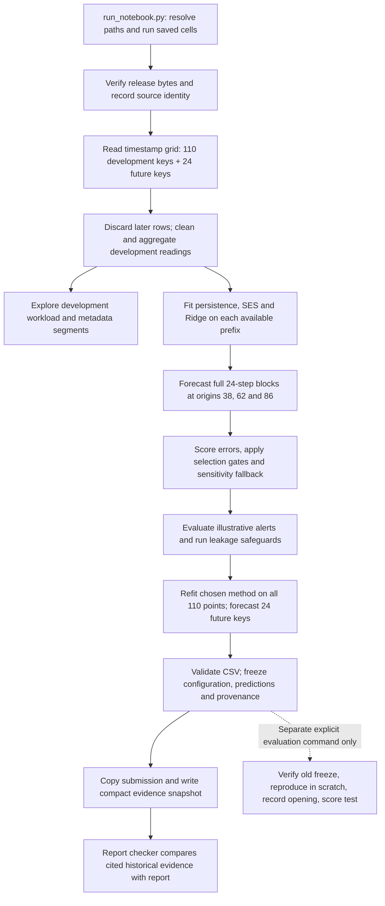

# Read the forecasting code from the challenge down to each function

Start here for the overall design, then read the XML-tagged comments next to the
implementation in [the notebook](notebooks/01_forecasting.ipynb). The notebook is
the forecasting implementation; `src/` is an unused package stub. The comments
explain inputs, operations, outputs, edge cases and design tradeoffs. Tags such as
`<stage>`, `<function>`, `<how>`, `<why>`, `<tradeoff>` and `<challenge>` organize
documentation inside ordinary Python comments. They are not executable XML or a
new configuration format. Additional tags name local concerns, such as provenance.

The explanations describe the implemented choices. A reason a method is suitable
is not proof it beats every alternative. Recorded results are development evidence,
not final-holdout accuracy.

## The problem that determines the design

The governing documents are
[ASSIGNMENT.md](https://github.com/atomityhq/forecasting-challenge/blob/main/ASSIGNMENT.md),
[DATASET.md](https://github.com/atomityhq/forecasting-challenge/blob/main/DATASET.md) and
[SUBMISSION.md](https://github.com/atomityhq/forecasting-challenge/blob/main/SUBMISSION.md).
This repository pins their contract to challenge commit
`6e5ac0e4d2f1d81fab0903ce0a974037745db35b` and release `data-v1`.
The linked assignment's `main` version was also read for these annotations and
matched the pinned assignment text. The release card describes complete-trace
selection, followed by deterministic category/core-bucket stratification.

The challenge has 10,000 VMs and 134 five-minute timestamps: 1.34 million raw
readings, but only **110 time points for developing each aggregate forecast**.
The final 24 timestamps form one two-hour test window. Many VM rows make the
aggregate well measured; they do not supply thousands of independent histories
of the aggregate. This distinction motivates a small candidate set and cautious
claims about validation.

| Challenge obligation | Implementation | Requirement versus local decision |
|---|---|---|
| Understand workload, quality, churn, segments and peaks (§3A) | Notebook §§3–7 | Required investigation; quantiles, ACF and contribution tables are chosen diagnostics |
| Distinct observed VM count and arithmetic mean CPU (§3B; DATASET §4) | `clean_cpu`, `aggregate_targets` | Required targets; exact duplicate removal, invalid-average exclusion and refusal of gaps are documented local policies |
| First 110 / final 24, five-minute output (§3C) | `timestamp_grid`, `load_development`, `check_predictions` | Required split and timestamps; no hardcoded VM population in forecasting |
| Baseline and temporal validation (§3D–E) | `forecast_values`, `backtest` | Required comparison; persistence, SES, Ridge and the three origins are local choices |
| Multiple error measures and failure analysis (§3F) | `error_metrics`, `summarize`, notebook §§11–13 | MAE, RMSE, baseline-relative and peak analysis required; thresholds and acceptance gates are local heuristics |
| Operational recommendation (§3G) | `alert_outcome`, notebook §14 | Required interpretation; prefix-P90 review alert and illustrative costs are local scenarios |
| Reproducible predictions and report (§7; SUBMISSION) | Runner, freeze manifest, report checker, synthetic suite | Required deliverables; content-addressed snapshots and the evaluation gate are this repo's safeguards |

## Follow one run

1. **Runner and setup — notebook §§0–2.** The runner executes saved Python cells
   in one shared namespace and a fresh process. This gives the report and CLI the
   same implementation and avoids relying on out-of-order notebook state.
   Imports are followed by dependency/numerical checks. Python 3.11+ and the six
   exact pins are repository runtime choices, not modeling requirements of the
   assignment. Archive and file hashes check identity; a smoke dataset can run
   but is explicitly distinguished from the actual release.
2. **Data boundary — §§3–4.** The timestamp-only pass determines the 134-key
   grid and split without counting future VMs. The chunk reader parses CSV rows,
   then removes later rows before cleaning, aggregation or diagnostics. Thus the
   guarantee is that holdout values do not influence development, not that their
   bytes are never read or parsed. A second implementation using Python CSV and
   `math.fsum` checks the development targets independently of pandas grouping.
3. **Workload understanding — §§5–7.** The notebook examines both the overall
   mean and the hot-VM tail: a low mean can hide busy VMs. Segment contributions
   use the full cohort denominator so they sum back to the required mean.
   ACF and within-hour patterns are descriptive. Relative trace seconds do not
   establish a wall-clock time or timezone, and nine observed hourly cycles
   cannot establish daily/weekly seasonality. These diagnostics do not silently
   expand the frozen feature set.
4. **Predictors and fitting — §§8–9.** A training label at index `i` receives
   values at `i-1`, `i-2`, `i-3` and the mean of `i-6` through `i-1`.
   Six incomplete rows are removed. No centered window or current label enters
   the features. Metadata is descriptive, not predictive: full-trace CPU summaries
   and deletion times reveal future information, and other fields' origin-time
   availability is not established.
5. **Compare before choosing — §§10–13.** Every candidate gets the same origins,
   timestamps and persistence reference. Selection first applies practical gates,
   then checks the initial choice under timing/window changes. Reusing these
   windows to choose a method makes their scores development estimates. The
   protocol does not convert three windows into a statistically conclusive trial.
6. **Operations and verification — §§14–15.** A review alert is issued once per
   two-hour block using a threshold available at its origin. Always-alert and
   never-alert expose whether forecasting adds anything to the scenario. Future
   perturbations and prefix-only execution check that forecasts and fitted state
   stay unchanged when unknown values change; intentionally leaky controls check
   that the detector can catch known faults.
7. **Forecast and freeze — §§16–18.** The chosen method is refit on all 110
   points. Predictions are validated before and after CSV serialization, then
   hashed with data, source, configuration, environment and decisions. The
   manifest is written last. Optional evaluation verifies that same procedure
   and its reproduced forecasts before using observed holdout targets. No real
   holdout evaluation is needed to read or test this implementation.

## Why these particular choices fit these data

**Target meaning comes before model choice.** At time `t`, count unique VMs
with a valid average and take the ordinary mean of those averages. Idle 0% VMs
count. An invalid average leaves both count and CPU denominator; contradictory
present bounds fail. An exact duplicate contributes once, a conflicting pair
fails, and a timestamp without usable readings fails instead of becoming zero.
A 2-core VM and a large VM receive equal weight because that is the required
estimand. Core-weighted utilization would answer another question, and bucketed
metadata cannot establish exact used cores.

**There is an intentional ordering difference from the literal assignment.**
ASSIGNMENT §3B says to construct the full target series before splitting.
Development here filters first and constructs only the prefix, keeping future
values and per-time VM counts out of development audits as well as fitting.
Each target depends only on readings at its own timestamp, so the fixed rules
make prefix construction equivalent for the first 110 values. A synthetic fixture
checks that property now; a real full-series comparison is deferred to the
explicit frozen evaluation. This is the repository's rationale for a departure
from the requested ordering, not proof a reviewer must accept the departure.

**Persistence is a serious candidate.** It repeats the last observed value,
has no estimated parameters and forecasts a constant count exactly when the
development cohort is constant. Complete-trace selection explains the observed
constant count; it does not imply a live cloud fleet has no churn. The fallback
uses the actual last value, not the release's advertised population size.

**SES asks whether a smoothed level is better.** Its one coefficient balances
recent values against the prior level. One-step squared errors within the
available prefix fit that coefficient, including boundary alternatives. SES then
repeats its final level for all 24 steps. It is a small alternative to persistence,
not a trend or seasonal model, and its fit objective differs from the multi-step
validation MAE used for comparing methods.

**Ridge asks whether recent shape helps.** Four lag/mean predictors are correlated;
an L2 penalty constrains coefficients compared with unregularized regression.
`StandardScaler` is fit inside each training prefix so the penalty acts in
comparable feature units without learning from validation rows. The SVD solver
handles the small dense fit deterministically. The three fixed penalties keep
the search small; no claim is made that trees or neural models were empirically
ruled out. With a short or constant history the code falls back to persistence.

**Recursive forecasting matches one two-hour issuance.** Ridge predicts the next
step, appends its own prediction, updates the lags/mean and repeats 24 times.
This shares a small one-step model across horizons but can accumulate error.
Feeding actual validation values back would instead test repeated one-step
forecasting, an easier problem than the required fixed-origin forecast. Separate
direct models would avoid recursive feedback but require more horizon-specific
fits from the same short history. Fixed CPU/count bounds are applied during
recursion, not learned from future extrema. Count forecasts need not be integers
under SUBMISSION.md.

**Validation matches the horizon and respects order.** Origins here are exclusive
training lengths, not timestamps: `[0:38] -> [38:62]`, `[0:62] -> [62:86]`,
`[0:86] -> [86:110]`. Each fold forecasts 24 steps without intermediate updates.
A random VM-row split could put the same time's workload in training and test.
Overlapping sensitivity runs are not extra independent experiments. A one-bin
delay forecasts 25 steps from an older prefix and scores steps 2–25 so requested
timestamps stay aligned.

**A win must survive more than a pooled average.** MAE describes average absolute
error; RMSE emphasizes larger misses. Pooled RMSE is computed from pooled squared
errors, not by averaging window RMSEs. CPU errors are percentage points. Skill is
`1 - model_MAE / persistence_MAE`; a zero-error baseline gives N/A, not an
epsilon-adjusted percentage. CPU peaks use each training prefix's P90. The local
gate needs 5% MAE improvement, two window wins, no RMSE degradation and at most
5% peak-MAE degradation with at least three peak points. A 1% tie band favors
the locally declared simpler option. Sensitivity can then send the initial
choice back to persistence without searching for a replacement.

The historical report's initial CPU challenger, `ridge_1`, improved pooled MAE
by 17.6%, but lost its advantage with one window removed and with a one-bin
delay. The final recorded choice is persistence for both targets. That is a
robustness decision under these heuristics, not a proof persistence is optimal.
One current limitation is important when reading `choose_models`: peaks are
defined only for CPU, but the peak gate applies to both targets. A count
challenger therefore cannot qualify even if a replacement dataset has varying
counts. The supplied constant-count development data do not require one; this
annotation task leaves that behavior unchanged.

**An alert is weaker than a provisioning recommendation.** P90 means unusually
high utilization relative to the observed prefix, not host saturation. The miss
costs of 3/10 and false-alert cost of 1 are illustrative units. The 0.7 percentage
point headroom example was chosen after seeing development errors; it is not a
calibrated prediction interval. Three windows and two events do not establish
reliable deployment benefits. Neither the mean nor resource buckets justify
claims of physical capacity or money saved.

## Supporting files and how to verify a reading

| File | Follow these functions / blocks | Purpose |
|---|---|---|
| `run_notebook.py` | `main` → saved cells → `sha256` → `snapshot_evidence` | Reproduce predictions and preserve compact evidence without a second model implementation |
| `reports/report_tables.py` | `rows`, `signed`, `table` → `tables`, `claims` → `main` | Render five report tables and check its known numeric claims against the cited snapshot and submitted CSV |
| `tests/run_synthetic_checks.py` | fixture helpers → `check_constant_releases`, `check_protocol`, `check_data_v1_snapshot` → `main` | Exercise multiple runs, refused tampering, repeat evaluation and immutable evidence on temporary synthetic projects |
| `src/__init__.py` | Package marker only | No model code or training side effect |

`reports/report_tables.py --check` verifies consistency with the **cited historical
snapshot**. It does not certify that the current edited source produced that
snapshot, independently verify model quality, or understand arbitrary prose.
Without `--check` it rewrites the table blocks; prose changes remain manual.

The source fingerprint includes code comments. These explanations preserve the
executable Python syntax tree, but change the notebook/runner source identity.
An old freeze will therefore refuse evaluation under the annotated sources.
Keep historical snapshots and the submitted CSV intact; generate a new
development freeze in a separate output directory if current-source evidence is
needed. Notebook markdown and outputs are excluded from the code-cell digest.
The manifest records provenance, not an access-control barrier against someone
bypassing the protocol.

Use the environment's `.venv/bin/python` from the repository root to run
`tests/run_synthetic_checks.py` and `reports/report_tables.py --check`. The first
uses only synthetic data; the second reads the cited saved evidence. For real-data
development, use the runner's `--output`, `--predictions` and `--evidence` overrides
to keep new artifacts separate. Leave `--evaluate-holdout` off while developing.
