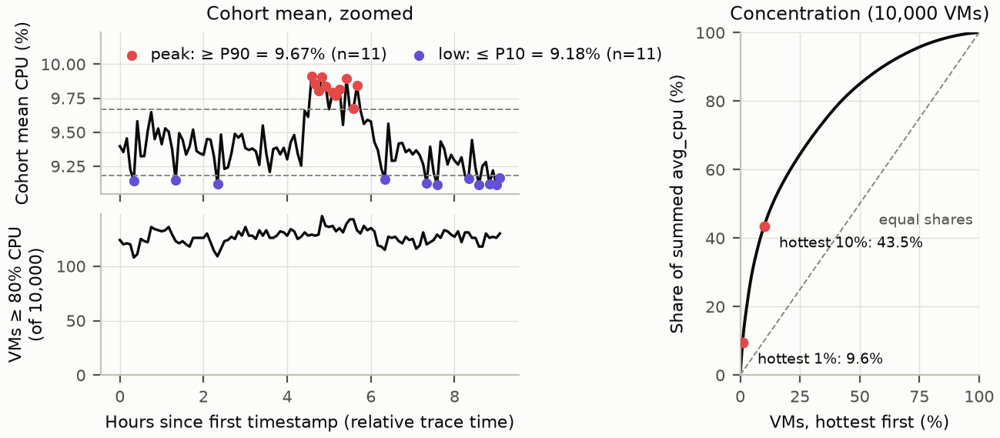
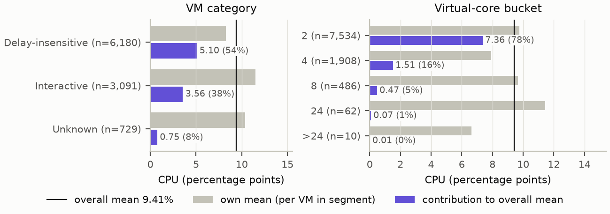
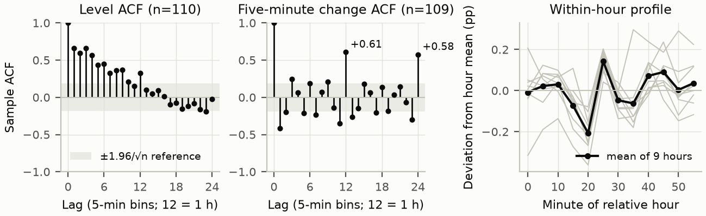
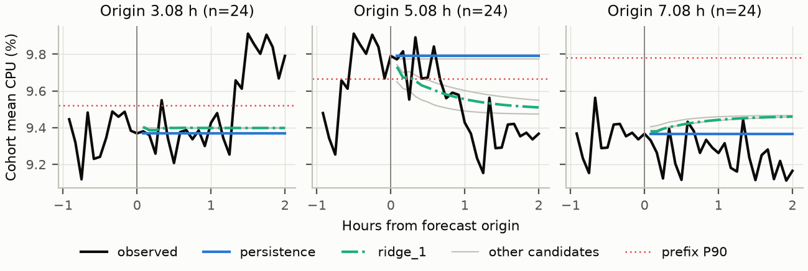
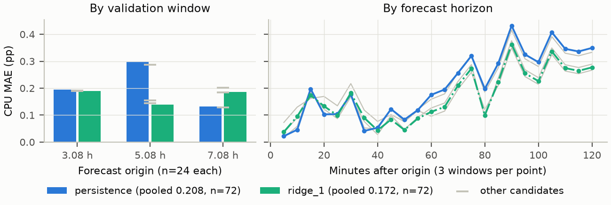

# Cloud Workload Forecasting — Final Report

**Data:** `data-v1` (archive SHA-256 `d04d402a…caeb`, the GitHub release-asset digest). **Contract:**
`atomityhq/forecasting-challenge@6e5ac0e`. **Code:** `notebooks/01_forecasting.ipynb`, run by
`run_notebook.py`. **Evidence:** every table comes from the tracked snapshot
`reports/evidence/d21d137c7ebf7bd1/`; `reports/report_tables.py` generates them and checks the key numbers in
the text. Validation scores are **development estimates**, because the same three windows chose the model.
The real 24-step holdout has **not** been opened.

## 1. Executive summary

- **Both targets are forecast with persistence.** `active_vm_count` is exactly 10,000 at all 110 development
  timestamps because the release keeps only complete traces, so every candidate ties persistence at zero
  error. The CPU forecast is the last development value, 9.1646%, at all 24 timestamps (33,000–39,900 s).
- **A challenger scored better pooled, then failed the predeclared stability checks.** Ridge autoregression
  (α=1) cut pooled CPU MAE by 17.6% (0.172 vs 0.208 pp) and passed every improvement gate, but the gain came
  from one window: it reversed with that window left out (−14.8%) and with data five minutes late (−0.6%), so
  the rule, fixed before scoring, keeps persistence. SES beat persistence in every window, but only by 3.1%.
- **A stable mean hides hot VMs.** The cohort mean stays within 9.11–9.91%, yet at every development
  timestamp 108–146 VMs (median 127) average 80% CPU or more, and the hottest 10% of VMs supply 43.5% of summed
  utilization. The mean dipped at minute 20 in all 9 complete development hours.
- **Operational reading.** In three development windows with two events, forecast-triggered review alerts did
  not beat a fixed two-hour review under either assumed cost ratio. The aggregate measures no physical
  capacity, so no provisioning risk, buffer cost or saving was assessed.

## 2. Data understanding and preprocessing

**Integrity and isolation.** The archive and its content files match the release-asset digest,
`SHA256SUMS` and pinned digests. The split was fixed from the sorted unique `timestamp` keys before any VM ID
or CPU value was read (134 keys 300 s apart; development 0–32,700 s, forecast 33,000–39,900 s), and later rows
are dropped on their key, so no development cell uses a holdout value or VM count. Each target at *t* uses
only readings stamped *t*, so the full series' first 110 rows equal the development series (ASSIGNMENT §3B;
checked on synthetic data); the full series is built only at evaluation, which has not run on `data-v1`.

**Measured and defined.** There are 1,100,000 development rows, 10,000 VMs at each of the 110 keys, with no
missing, duplicate, out-of-range or inconsistent value, one metadata row per VM, and category counts (6,180 /
3,091 / 729) matching the data card. `active_vm_count(t)` counts distinct VMs with a valid reading at *t*,
idle VMs included; `aggregate_cpu_utilization(t)` is their unweighted mean `avg_cpu`, in percent. Invalid
averages leave numerator and denominator; conflicting duplicates, contradictory bounds and grid gaps stop the
run; nothing is imputed. Hand-calculated fixtures cover each rule (VMs at 0 and 80%, then 20 and 60%, give
N=2 and U=40%; core-weighting would give 64%), and an independent `csv`/`math.fsum` implementation
reproduces all 110 targets.

## 3. Workload analysis (development only)

*Figure 1. Cohort mean CPU (n=110, zoomed) with peaks ≥ P90 and lows ≤ P10; VMs averaging ≥ 80% CPU, of
10,000; share of summed `avg_cpu` from the hottest VMs. The quantiles are descriptive; 80% is a marker, not an SLA.*

All 11 peak timestamps (≥ P90 = 9.67%) fall in one 4.6–5.7 h episode; six of the 11 lows (≤ P10 = 9.18%)
sit at minute 20 of a relative hour, the rest in the last 1.5 h. No step is a robust outlier; nothing was
deleted. No VM arrives or leaves and every VM was created at or before the first timestamp: the flat count
reflects complete-trace curation. Only 1.27% of readings reach 80%, yet 437 VMs do so at least once and 99
average it; the median VM averages 5.5%.

*Figure 2. Segment own mean CPU (grey) and contribution to the required unweighted mean (violet); n counts
VMs. Contributions add to the mean at every timestamp.*

Interactive VMs have the highest own mean (11.5%), but Delay-insensitive VMs contribute most (5.10 of 9.41 pp,
54%) because they are 62% of VMs; 2-core VMs contribute 78%. The 24-core bucket has the highest own mean among
core buckets (11.4%) yet contributes 0.07 pp: the mean follows the many small VMs and is not a capacity
measure. These differences are associations, not causes.

*Figure 3. Autocorrelation of the cohort mean (n=110) and its five-minute changes (n=109), with the ±1.96/√n
white-noise reference (not a test); right, deviation from each complete hour's mean (grey) and the average.*

Five-minute changes have autocorrelation −0.41 at lag 1 (rises tend to reverse), +0.61 at one hour and
+0.58 at two hours. In all 9 complete hours, minute 20 sits below the hour mean (−0.21 pp on average) and
minute 25 above it (+0.14 pp). Its cause is unknown; the minute was picked post hoc, nine cycles cannot
establish a stable cycle, and 11.1 hours cannot reveal daily or weekly seasonality.

## 4. Forecasting approach

Candidates, features and rules were frozen before any validation score existed. **Persistence** repeats the
last value; **SES** fits one smoothing coefficient by one-step squared error; **Ridge autoregression**
(α ∈ {1, 10, 100}) uses lags 1–3 and a trailing six-bin mean, standardized on the training prefix, and
forecasts 24 steps recursively from its own forecasts. CPU is clipped to [0,100] (never needed); a constant
prefix falls back to persistence. Metadata, calendar features and holdout values are never inputs.

## 5. Validation methodology

Each fold trains on rows [0, *e*) and forecasts [*e*, *e*+24) from one origin, for *e* = 38, 62, 86 (3.08,
5.08 and 7.08 h): three non-overlapping two-hour blocks, issued like the final forecast and scored on the same
timestamps against the same persistence forecast. CPU peaks are actuals at or above the training prefix's
P90; the count has none, so the peak guard keeps it on persistence.

**Predeclared rule.** A challenger must cut pooled MAE by at least 5%, win two of three windows, not worsen
pooled RMSE, and worsen peak MAE by at most 5% (with at least 3 peak points); among qualifiers within 1% of the
best MAE, the simplest wins. It must then stay ahead with origins six bins earlier, with a one-bin data delay
and with each window left out, or the rule falls back to persistence.

**Leakage checks (all passed).** Each fold is rerun from fresh state with every later target shifted (CPU
+50 or +60 pp, count +7 or +8) and with later targets unknown; forecasts and fitted state stay identical on synthetic and
development series. Deliberately leaky controls (teacher forcing, a globally fitted scaler) are caught at
every origin of the nonconstant synthetic series and of the `data-v1` series. Other leakage paths remain
possible.

## 6. Results versus baseline (development estimates)

<!-- table:cpu-results -->
| CPU, n=72 | MAE (pp) | RMSE (pp) | MAE vs persistence | Windows won | Peak MAE (pp), n=16 | Gate |
|---|---:|---:|---:|---:|---:|---|
| persistence | 0.208 | 0.268 | — | — | 0.271 | baseline |
| SES | 0.202 | 0.258 | −3.1% | 3/3 | 0.254 | fails 5% gain |
| ridge_1 | **0.172** | **0.216** | −17.6% | 2/3 | 0.273 (+0.5%) | passes; initial choice |
| ridge_10 | 0.176 | 0.221 | −15.3% | 2/3 | 0.260 | passes; not within 1% of ridge_1 |
| ridge_100 | 0.179 | 0.219 | −14.2% | 2/3 | 0.301 (+10.8%) | fails peak guard |
<!-- /table -->

Stability checks for the initial choice (each must keep the challenger ahead):

<!-- table:sensitivity -->
| Check | ridge_1 MAE (pp) | persistence MAE (pp) | Result |
|---|---:|---:|---|
| Origins six bins earlier | 0.166 | 0.189 | holds |
| One-bin data delay | 0.173 | 0.172 | **fails** |
| Leave out origin 38 | 0.162 | 0.215 | holds |
| Leave out origin 62 | 0.188 | 0.164 | **fails** |
| Leave out origin 86 | 0.164 | 0.246 | holds |
<!-- /table -->

Both failures trigger the declared fallback, so the decision is **persistence**. **Count:** every candidate
has zero error on 72 points; relative improvement is **N/A**, an exact tie rather than a gain. Appendix A
gives each candidate's MAE in each window.

## 7. Error and failure analysis

*Figure 4. Observed mean (black) and 24-step forecasts of persistence (blue) and ridge α=1 (green, dash-dot)
per validation window (n=24, zoomed), after one hour of context; grey, other candidates; dotted, the prefix
P90 used for peaks and alerts. The count target is forecast exactly and not shown.*

Errors come from level shifts no candidate anticipates. At origin 62 the forecast starts inside the peak
episode: persistence carries the peak forward while the level falls, and ridge's pull toward the training mean
wins (MAE 0.14 vs 0.30), but it loses at origin 86, where the level keeps drifting down (0.19 vs 0.13). At
origin 38 nothing foresees the episode's onset; persistence under-forecasts by up to 0.54 pp.

*Figure 5. CPU MAE by validation window (n=24 each) and by horizon (each point averages three windows); grey,
other candidates; the legend gives pooled MAE over 72 points.*

Persistence MAE is 0.108 pp at horizons 1–6, 0.099 at 7–12 and 0.313 at 13–24; in the first 30 minutes
persistence and SES (0.110) beat ridge_1 (0.120). Minutes 20 and 25 carry 16.3–16.7% of absolute error, about
their share of time. Every origin falls at minute 5 of an hour, so horizon and phase are confounded; no
calibrated uncertainty band was produced.

## 8. Capacity-planning recommendation

The target is an unweighted mean of per-VM percentages across 2- to >24-core VMs. It can schedule a review,
but it cannot size capacity: it converts to no number of cores, and the release has no prices.

**Evaluated policy.** At each origin, alert for review if any forecast in the next two hours reaches the
training prefix's P90; an event is any actual value at or above it. Costs, fixed before scoring, are 1 per
unnecessary alert and 3 or 10 per miss, in illustrative units.

<!-- table:policy -->
| Policy (3 windows, 2 events) | Alerts | Misses | False alerts | Cost, miss = 3 | Cost, miss = 10 |
|---|---:|---:|---:|---:|---:|
| persistence (selected), SES, ridge_1, ridge_10 | 1 | 1 | 0 | 3 | 10 |
| ridge_100 | 0 | 2 | 0 | 6 | 20 |
| always alert | 3 | 0 | 1 | **1** | **1** |
| never alert | 0 | 2 | 0 | 6 | 20 |
<!-- /table -->

Two of the three windows hold an event, first crossing 20 and 5 minutes after the origin, because one reading
above P90 is enough. Flat forecasts alert only when the level is already above it (origin 62, where ridge_1
and ridge_10 also alerted; ridge_100 never did), and nothing foresaw the origin-38 crossings. With three
windows this ranking is fragile.

**Safety margin (descriptive).** Errors of the selected forecast in the development windows:

<!-- table:headroom -->
| persistence, n=72 | Median abs. error | P90 abs. error | Max abs. error | Largest under-forecast | Covered by +0.7 pp |
|---|---:|---:|---:|---:|---:|
| CPU, pp | 0.16 | 0.47 | 0.64 | 0.54 | 72 of 72 |
<!-- /table -->

A 0.7 pp margin above the forecast would have covered every development observation, but it was chosen after
seeing these errors, and the largest under-forecast came from one window (origin 38). The margin is not a
calibrated interval, its coverage on new data is unknown, and it shows no capacity saving: a wider margin
trades fewer missed peaks for unused allocation, which this target cannot quantify.

**Recommendation.** (1) Treat the count as fixed for this curated cohort; a live fleet needs arrival and
departure data. (2) Forecast CPU with persistence and review on a fixed two-hour cadence rather than on
forecast-triggered alerts: that cadence had the lowest illustrative cost under both cost ratios, in three
windows with two events. (3) The mean hides the VMs averaging 80% or more; whether they need per-VM rules was
not evaluated. The final forecast (9.16%) is below the development P90 (9.67%), so the forecast-triggered rule
would not alert; the fixed review applies regardless.

## 9. Limitations and future work

Every score is a development estimate from 110 points and three windows that also chose the model; the
holdout evaluation is tested on synthetic data only. Curation fixes the count and limits generalization; the
unweighted mean is not demand or capacity, core and memory sizes are bucketed, and memory utilization is
absent; there is no wall-clock mapping. Future work: a pre-registered hour-phase or seasonal-naive-12 candidate judged on new data,
sustained-crossing alerts and VM-level hot-spot rules.

## Appendix A. CPU MAE by validation window

<!-- table:cpu-windows -->
| MAE (pp) at origin | 38 | 62 | 86 |
|---|---:|---:|---:|
| persistence | 0.195 | 0.297 | 0.132 |
| SES | 0.190 | 0.286 | 0.129 |
| ridge_1 | 0.190 | 0.139 | 0.186 |
| ridge_10 | 0.190 | 0.154 | 0.184 |
| ridge_100 | 0.190 | 0.144 | 0.202 |
<!-- /table -->

**Reproduction.** `python run_notebook.py --data challenge_data --output reports/generated` regenerates
every output: `predictions.csv` (SHA-256 `ce15e40b…7584`, Windows CRLF bytes) and an evidence snapshot per
frozen run (any change, a commit included, gives a new one); `python reports/report_tables.py --check`
verifies this report against the cited snapshot. `reports/evidence/e87c877f9b04d5cc/` keeps the previous
run, with identical predictions. `--evaluate-holdout` has run on synthetic data only. See `TESTING.md`.
